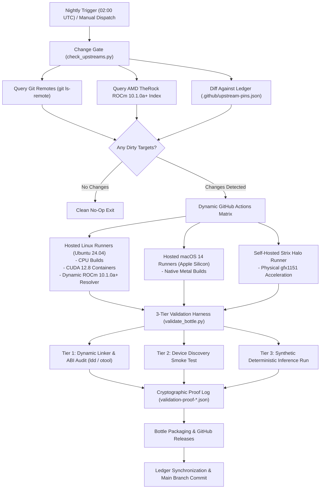

# 🍺 Heretek-AI Homebrew Tap: High-Performance GPU Inference Engines & APU Runtimes

<div align="center">

[](https://github.com/Heretek-AI/homebrew-tap/actions/workflows/nightly-matrix.yml)
[](https://github.com/Heretek-AI/homebrew-tap/actions/workflows/tests.yml)
[](https://github.com/Heretek-AI/homebrew-tap/actions/workflows/build-rocmfpx.yml)
[](LICENSE)
[](https://nightly.repo.amd.com/rocm/core/tarball/)
[](https://developer.apple.com/metal/)
[](https://developer.nvidia.com/cuda-toolkit)
[](https://mesa3d.org)

<p align="center">
  <b>Turnkey Homebrew tap delivering pre-compiled, accelerator-optimized packages for 15 LLM, vision, APU harness, and low-level kernel runtimes:</b><br/>
  <b><a href="#-rocmfpx">rocmfpx</a></b> •
  <b><a href="#-gufo">gufo</a></b> •
  <b><a href="#-gufetto">gufetto</a></b> •
  <b><a href="#-gufo-franzmoca">gufo-franzmoca</a></b> •
  <b><a href="#-qwenox">qwenox</a></b> •
  <b><a href="#-crucible-strix-halo">crucible-strix-halo</a></b> •
  <b><a href="#-strixite">strixite</a></b> •
  <b><a href="#-snowllm">snowllm</a></b> •
  <b><a href="#-strata">strata</a></b> •
  <b><a href="#-project-maya">project-maya</a></b> •
  <b><a href="#-kyojin">kyojin</a></b> •
  <b><a href="#-hyperqwen">hyperqwen</a></b> •
  <b><a href="#-lucebox">lucebox</a></b> •
  <b><a href="#-shimmy">shimmy</a></b> •
  <b><a href="#-stable-diffusion-cpp">stable-diffusion-cpp</a></b>
</p>

</div>

---

## ⚡ Quick Start

```bash
# 1. Tap the Heretek-AI repository
brew tap Heretek-AI/tap

# 2. Install desired packages:
# --- AMD Strix Halo (gfx1151) & Strix Point (gfx1150) APU Runtimes ---
brew install gufo                 # Canonical upstream C++20/HIP Strix Halo runtime
brew install gufetto              # C++23 runtime with Flash-Next rotated KV cache & admission planner
brew install gufo-franzmoca       # DeepSeek-V4.1-Flash (763B SSD streaming) & Gemma 4 MTP engine
brew install qwenox               # High-performance Qwen runtime & kernel primitives for Strix Halo
brew install crucible-strix-halo  # Dedicated AMD Strix Halo kernel harness & memory allocator tuners
brew install strixite             # Zero-dependency C++20/HIP Qwen3.8-Flash-Next runtime (.strixw v2)
brew install snowllm              # Lightweight embedded C++ LLM runner with Ryzen AI Max APU kernels

# --- Low-Level Acceleration Kernels & Canonical Stacks ---
brew install rocmfpx              # Canonical ROCm llama.cpp stack with FP8/FP4/hipBLASLt primitives
brew install stable-diffusion-cpp # Fast SD, SDXL, Flux, SD3 & Wan diffusion inference
brew install shimmy               # Pure-Rust WebGPU & CUDA compatibility server
brew install lucebox              # Containerized toolchain sandbox and accelerated workspace launcher

# --- Tiered MoE & Multi-Model Engines ---
brew install strata               # Tiered MoE engine (Qwen3.8, Qwen3.6-35B, DeepSeek-V4.1)
brew install project-maya         # Multimodal tiered engine (GLM-5.3-Flash, MiniMax, DeepSeek-V4.1)
brew install kyojin               # ExLlamaV3 Strix Halo / RDNA4 suite with specialized servers
brew install hyperqwen            # NVIDIA CUDA 12.8+ vLLM appliance (sm_80..sm_120)

# 3. Optional: Start background daemon (runs on boot):
brew services start gufetto
# or
brew services start rocmfpx
```

> [!IMPORTANT]
> **⚡ Zero-Dependency Precompiled Bottles vs. Source Builds**:  
> - **Precompiled Bottles (`brew install <formula>`):** Bottles link against system runtimes or dynamically isolated toolchain libraries.
> - **Custom Acceleration Source Builds (`--with-rocm`):** Pass `HOMEBREW_ROCM_PATH=/path/to/rocm` (or have `/opt/rocm-nightly` / `/opt/rocm` present) when invoking Homebrew to override toolchain paths for HIP and clang++ builds.

---

## 📊 Master Package Matrix (All 15 Formulas)

| Formula | Description | Upstream Source | Primary Languages | Supported Acceleration Backends | Default Backend |
| :--- | :--- | :--- | :--- | :--- | :---: |
| [**`gufo`**](#-gufo) | High-performance C++20 LLM runtime for Strix Halo | [`Heretek-AI/gufo`](https://github.com/Heretek-AI/gufo) | C++20, HIP, CMake | ROCm HIP (`gfx1151`) | ROCm HIP |
| [**`gufetto`**](#-gufetto) | C++23 LLM runtime with Flash-Next rotated KV cache | [`community-token-labs/gufetto`](https://github.com/community-token-labs/gufetto) | C++23, HIP, CMake | ROCm HIP (`gfx1151`) + XDNA 2 NPU | ROCm HIP |
| [**`gufo-franzmoca`**](#-gufo-franzmoca) | DeepSeek-V4.1 SSD streaming & Gemma 4 MTP engine | [`franzmoca/gufo`](https://github.com/franzmoca/gufo) | C++20, HIP, CMake | ROCm HIP (`gfx1151`) | ROCm HIP |
| [**`qwenox`**](#-qwenox) | Qwen runtime & kernel primitives for Strix Halo | [`IIIIIllllIIIIIlllll/Qwenox`](https://github.com/IIIIIllllIIIIIlllll/Qwenox) | C++20, HIP, Make/CMake | ROCm HIP (`gfx1151`) | ROCm HIP |
| [**`crucible-strix-halo`**](#-crucible-strix-halo) | Dedicated AMD Strix Halo kernel harness & memory tuners | [`jaedync/crucible-strix-halo`](https://github.com/jaedync/crucible-strix-halo) | C++20, HIP, CMake | ROCm HIP (`gfx1150`, `gfx1151`) | ROCm HIP |
| [**`strixite`**](#-strixite) | Zero-dependency C++20 Qwen3.8-Flash-Next runtime | [`shawnshekari/strixite`](https://github.com/shawnshekari/strixite) | C++20, HIP, CMake | ROCm HIP (`gfx1151`) | ROCm HIP |
| [**`snowllm`**](#-snowllm) | Lightweight embedded C++ LLM runner | [`snowllm/snowllm`](https://github.com/snowllm/snowllm) | C++20, HIP, Python | ROCm HIP (`gfx1150`, `gfx1151`) | ROCm HIP |
| [**`rocmfpx`**](#-rocmfpx) | Low-bit FP8/FP4/hipBLASLt primitives for llama.cpp | [`charlie12345/ROCmFPX`](https://github.com/charlie12345/ROCmFPX) | C/C++, HIP, CMake | ROCm HIP (`gfx1100`, `gfx1150`, `gfx1151`, `gfx90a`, `gfx942`) | ROCm HIP |
| [**`strata`**](#-strata) | Layered memory model virtualization & tiered MoE | [`Heretek-AI/Strata`](https://github.com/Heretek-AI/Strata) | C++17, HIP/CUDA/Metal | ROCm, Metal, CUDA, CPU | ROCm (Linux) / Metal (macOS) |
| [**`project-maya`**](#-project-maya) | Multimodal audio-visual tiered MoE engine | [`mw00/project-maya`](https://github.com/mw00/project-maya) | C++20, HIP/CUDA/Metal | ROCm, Metal, CUDA, CPU | ROCm (Linux) / Metal (macOS) |
| [**`kyojin`**](#-kyojin) | High-throughput multi-engine inference server | [`Yamz-Labs/kyojin`](https://github.com/Yamz-Labs/kyojin) | Python, C++20, HIP/CUDA | ROCm, CUDA | ROCm (Linux default) |
| [**`hyperqwen`**](#-hyperqwen) | Quantized Qwen inference engine and vLLM runtime | [`syv-ai/HyperQwen`](https://github.com/syv-ai/HyperQwen) | Python 3.12, CUDA C++17 | CUDA (`sm_80..sm_120`) | CUDA |
| [**`lucebox`**](#-lucebox) | Containerized toolchain sandbox & workspace launcher | [`Luce-Org/lucebox`](https://github.com/Luce-Org/lucebox) | Rust, Shell | Precompiled multi-arch CLI | CPU Multi-Arch |
| [**`shimmy`**](#-shimmy) | Dynamic IPC/API compatibility shims and LLM runner | [`Michael-A-Kuykendall/shimmy`](https://github.com/Michael-A-Kuykendall/shimmy) | Rust | CPU, Metal, Vulkan, CUDA | CPU (Linux) / Metal (macOS) |
| [**`stable-diffusion-cpp`**](#-stable-diffusion-cpp) | Fast image & video diffusion inference | [`leejet/stable-diffusion.cpp`](https://github.com/leejet/stable-diffusion.cpp) | C/C++, CMake | Vulkan, Metal, ROCm, CPU | Vulkan (Linux) / Metal (macOS) |

---

## 🎯 Accelerator Variant Installation Flags

Formulas in this tap provide explicit hardware acceleration options:

```bash
# Build / Install with AMD ROCm acceleration (e.g. Strix Point / Strix Halo / RDNA3 / RDNA4):
brew install <formula> --with-rocm

# Build / Install with NVIDIA CUDA acceleration:
brew install <formula> --with-cuda

# Build / Install with Apple Metal acceleration (macOS):
brew install <formula> --with-metal

# Build / Install with Vulkan SPIR-V acceleration:
brew install <formula> --with-vulkan

# Fallback to portable CPU-only builds:
brew install <formula> --with-cpu
```

### Passing Custom ROCm Paths
Because Homebrew sanitizes environmental variables during `brew install`, supply the ROCm installation path via `HOMEBREW_ROCM_PATH`:
```bash
HOMEBREW_ROCM_PATH=/opt/rocm-nightly brew install gufo --with-rocm
```

---

## 🔄 End-to-End Nightly CI/CD Pipeline Architecture

The tap features a matrixed CI/CD automation pipeline configured in [`.github/workflows/nightly-matrix.yml`](.github/workflows/nightly-matrix.yml) that executes on a nightly schedule (`02:00 UTC`) or manually via `workflow_dispatch`:



### 1. Dynamic AMD TheRock ROCm 10.1.0a+ Resolver ([`.github/scripts/resolve_rocm_sdk.sh`](.github/scripts/resolve_rocm_sdk.sh))
- Primary index: `https://nightly.repo.amd.com/rocm/core/tarball/` (fallback to `https://rocm.nightlies.amd.com/tarball-multi-arch/`).
- Resolves daily `10.1.0a+` nightly archives matching `therock-dist-linux-gfx1151-*.tar.gz`, `gfx1150`, or multiarch tarballs.
- Filters out non-runtime packages (such as `-tests-`).
- Supports ETag and filename HTTP caching to prevent redundant bandwidth downloads.
- Unpacks to `/opt/rocm-nightly`, sets `HIP_PATH`, `ROCM_PATH`, and configures clang++ / lld symlinks.

### 2. State Ledger & Change Gate ([`.github/upstream-pins.json`](.github/upstream-pins.json) & [`.github/scripts/check_upstreams.py`](.github/scripts/check_upstreams.py))
- Tracks current git commit SHAs, release versions, ROCm build timestamps, and formula `.rb` checksums for all 15 projects.
- Detects new upstream commits and ROCm nightly updates.
- Skips unsupported hardware configurations with explicit reason strings (preventing fake or broken backend compilation).
- Emits a clean JSON matrix for GitHub Actions. If everything is up to date, exits cleanly without launching runners.

### 3. Three-Tier Validation Harness ([`.github/scripts/validate_bottle.py`](.github/scripts/validate_bottle.py))
Every built bottle undergoes rigorous verification before publication:
1. **Tier 1 (Linkage & ABI Audit)**: Runs `ldd` (Linux) or `otool -L` (macOS) to verify mandatory accelerator libraries (`libamdhip64.so`, `libhipblaslt.so`, `libcuda.so`, `Metal.framework`) link without orphan symbols or `not found` records.
2. **Tier 2 (Device Discovery Smoke Test)**: Executes `--list-devices`, `--info`, or backend diagnostics to verify hardware hooks initialize properly.
3. **Tier 3 (Deterministic Inference Run)**: Executes a synthetic golden test pass with assertions on exit code and throughput.
4. **Proof Generation**: Emits a cryptographically verified `validation-proof-<formula>-<variant>.json` log containing SHA256 checksums, dynamic linker outputs, compiler options, and runtime telemetry.

### 4. Supply Chain Security & Sigstore Attestation
Nightly bottles and proof logs published to GitHub Releases are attested using GitHub Actions Artifact Attestations (Sigstore):
```bash
# Verify cryptographic provenance of any downloaded bottle:
gh attestation verify bottle.tar.gz --owner Heretek-AI
```

---

## 💻 Local Tap Testing & Development

Run the complete test suite locally:

```bash
# Run Python unit tests for resolvers, validators, and gates:
pytest tests/ -v

# Run dry-run upstream change check:
python3 .github/scripts/check_upstreams.py --dry-run

# Test formula syntax and auditing inside Docker:
docker run --rm -v "${PWD}:/tap:ro" ghcr.io/homebrew/ubuntu24.04 bash -c \
  "brew style /tap/Formula/*.rb"

# Run ShellCheck on all bash scripts:
docker run --rm -v "${PWD}:/mnt" -w /mnt koalaman/shellcheck:stable \
  .github/scripts/resolve_rocm_sdk.sh .github/scripts/setup_ccache.sh scripts/test_local_tap.sh
```

---

## 📄 License
This Homebrew Tap and its CI/CD automation infrastructure are licensed under the [MIT License](LICENSE). Individual upstream packages remain licensed under their respective open-source licenses.